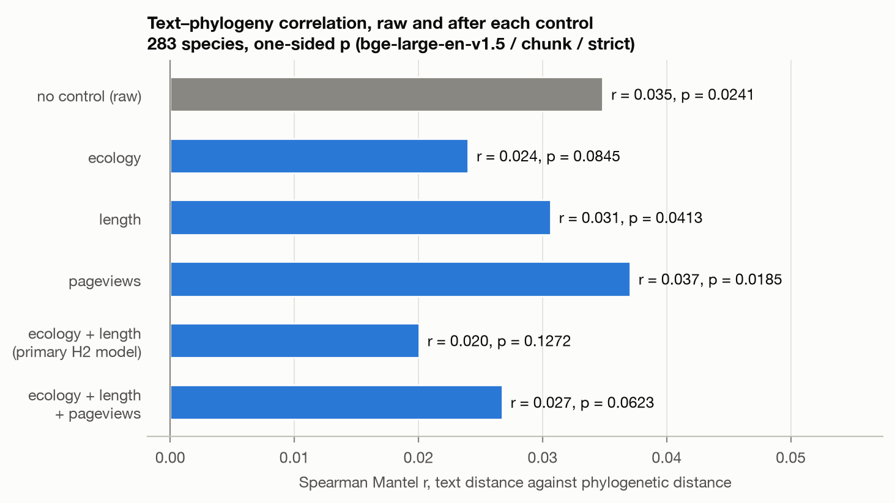
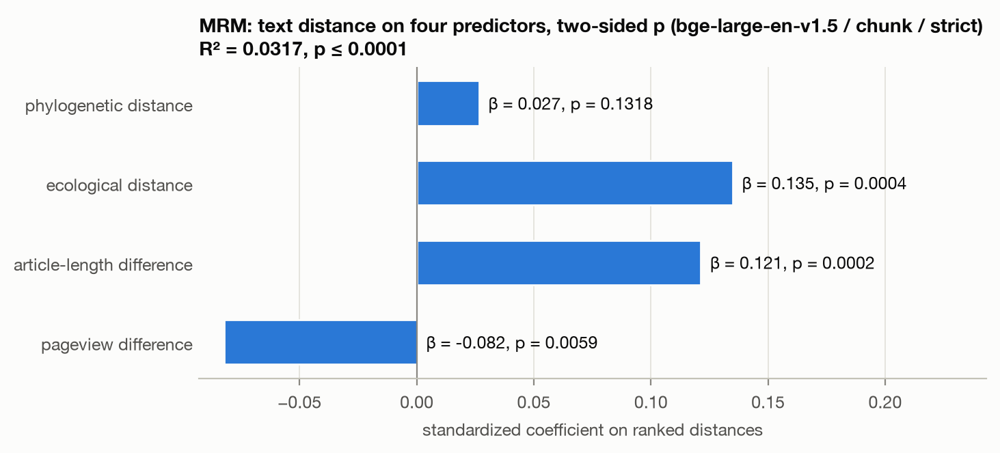
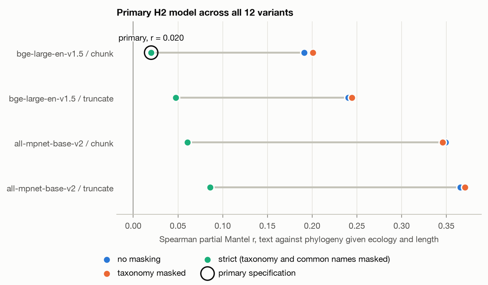
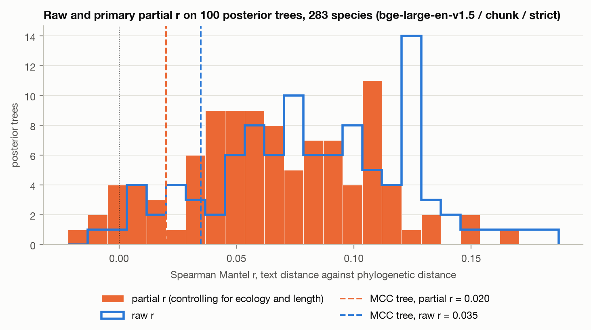
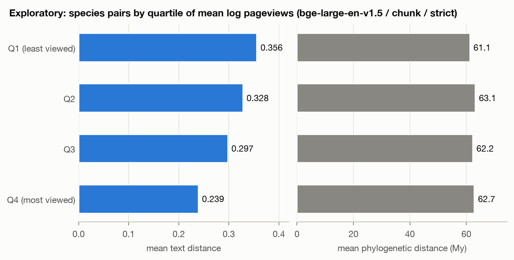
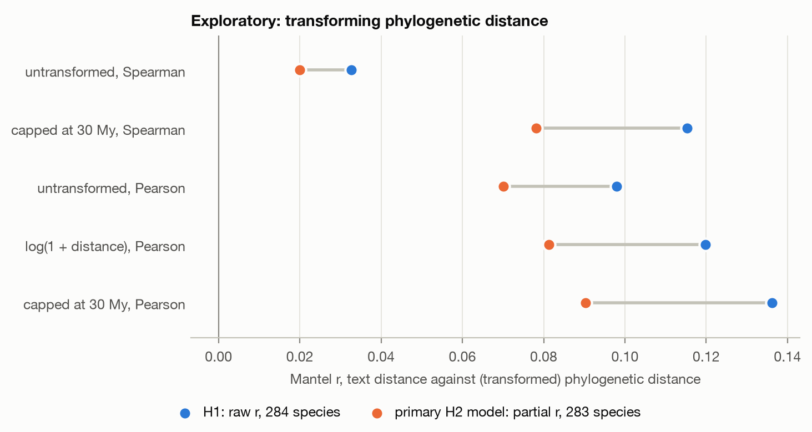

# Week 5 report: H2, partial Mantel tests and MRM

Generated 2026-10-09 19:29 UTC by `scripts/17_week5_report.py`. Clade: order Carnivora. Primary specification: bge-large-en-v1.5 / chunk / strict, Spearman. The H2 plan is `docs/preregistration_amendment_h2.md`, committed before any of these numbers existed. All tests use 9,999 permutations and seed 20261004. Partial Mantel p-values are one-sided; MRM p-values are two-sided.

## 1. H2 on the primary specification

Species: the 283 with ecology data (39,903 pairs). The raw correlation is recomputed on these species and is the baseline. The primary model controls for ecological distance (trait groups weighted equally) and the difference in log article length together.

| quantity | value | one-sided p |
|---|---|---|
| raw r (no control) | 0.0348 | 0.0241 |
| partial r (ecology + length) | 0.0200 | 0.1272 |
| raw r − partial r | 0.0148 |  |
| partial r as a share of raw r | 57.5% |  |

**Decision rules (fixed in the amendment, section 6):**

- (a) Lineage signal survives (partial r > 0 with one-sided p < 0.05): **no**.
- (b) Signal is largely confounded (partial r under 50% of raw r): **no**.

## 2. How much of the raw r remains after each control

Raw r on these species: 0.0348. Each row removes the listed controls from both text distance and phylogenetic distance.

| controls for | partial r | p | share of raw r | raw − partial |
|---|---:|---:|---:|---:|
| ecology | 0.0240 | 0.0845 | 69% | +0.0108 |
| length | 0.0306 | 0.0413 | 88% | +0.0042 |
| pageviews | 0.0370 | 0.0185 | 106% | -0.0022 |
| ecology + length (primary) | 0.0200 | 0.1272 | 58% | +0.0148 |
| ecology + length + pageviews | 0.0267 | 0.0623 | 77% | +0.0081 |

- Controlling for ecology: r goes from 0.035 to 0.024, which is 69% of the raw r.
- Controlling for length: r goes from 0.035 to 0.031, which is 88% of the raw r.
- Controlling for pageviews: r goes from 0.035 to 0.037, which is 106% of the raw r.
- Controlling for ecology + length: r goes from 0.035 to 0.020, which is 58% of the raw r.
- Controlling for ecology + length + pageviews: r goes from 0.035 to 0.027, which is 77% of the raw r.

## 3. MRM

Text distance regressed on four predictors, all as ranked distances, 283 species. p-values come from permuting the text matrix. R² = 0.0317 (permutation p = 0.0001).

| predictor | standardized coefficient | pseudo-t | p |
|---|---:|---:|---:|
| phylogenetic distance | 0.0265 | 5.34 | 0.1318 |
| ecological distance | 0.1348 | 27.27 | 0.0004 |
| article-length difference | 0.1212 | 21.69 | 0.0002 |
| pageview difference | -0.0821 | -14.62 | 0.0059 |

Coefficients on the unstandardized ranks are in `h2_mrm.csv` (`coef_raw`); every ranked matrix has nearly the same spread, so they match the standardized ones to four decimals.

## 4. Robustness

Reported in full; none of this decides H2. No correction for multiple testing.

### All 12 model, rule and mask variants

Primary H2 model (ecology + length) on each text matrix. Rule (a) holds in 11 of 12 and rule (b) in 0 of 12.

| model | rule | mask | raw r | raw p | partial r | p | share of raw r | raw − partial | rule (a) | rule (b) |
|---|---|---|---:|---:|---:|---:|---:|---:|---|---|
| bge-large-en-v1.5 | chunk | strict | 0.0348 | 0.0241 | 0.0200 | 0.1272 | 58% | +0.0148 | no | no |
| bge-large-en-v1.5 | truncate | strict | 0.0662 | 0.0001 | 0.0474 | 0.0020 | 72% | +0.0188 | yes | no |
| all-mpnet-base-v2 | chunk | strict | 0.0841 | 0.0001 | 0.0605 | 0.0003 | 72% | +0.0236 | yes | no |
| all-mpnet-base-v2 | truncate | strict | 0.1101 | 0.0001 | 0.0859 | 0.0001 | 78% | +0.0243 | yes | no |
| bge-large-en-v1.5 | chunk | taxonomy | 0.2165 | 0.0001 | 0.2010 | 0.0001 | 93% | +0.0155 | yes | no |
| bge-large-en-v1.5 | truncate | taxonomy | 0.2595 | 0.0001 | 0.2445 | 0.0001 | 94% | +0.0150 | yes | no |
| all-mpnet-base-v2 | chunk | taxonomy | 0.3549 | 0.0001 | 0.3460 | 0.0001 | 97% | +0.0090 | yes | no |
| all-mpnet-base-v2 | truncate | taxonomy | 0.3780 | 0.0001 | 0.3707 | 0.0001 | 98% | +0.0073 | yes | no |
| bge-large-en-v1.5 | chunk | none | 0.2063 | 0.0001 | 0.1912 | 0.0001 | 93% | +0.0151 | yes | no |
| bge-large-en-v1.5 | truncate | none | 0.2546 | 0.0001 | 0.2402 | 0.0001 | 94% | +0.0144 | yes | no |
| all-mpnet-base-v2 | chunk | none | 0.3581 | 0.0001 | 0.3491 | 0.0001 | 97% | +0.0090 | yes | no |
| all-mpnet-base-v2 | truncate | none | 0.3736 | 0.0001 | 0.3654 | 0.0001 | 98% | +0.0082 | yes | no |

MRM standardized coefficients for the same 12 text matrices:

| model | rule | mask | β phylogeny | β ecology | β length | β pageviews | p phylogeny | R² |
|---|---|---|---:|---:|---:|---:|---:|---:|
| bge-large-en-v1.5 | chunk | strict | 0.027 | 0.135 | 0.121 | -0.082 | 0.1318 | 0.032 |
| bge-large-en-v1.5 | truncate | strict | 0.050 | 0.141 | 0.191 | -0.045 | 0.0011 | 0.055 |
| all-mpnet-base-v2 | chunk | strict | 0.064 | 0.252 | 0.140 | -0.065 | 0.0001 | 0.086 |
| all-mpnet-base-v2 | truncate | strict | 0.084 | 0.255 | 0.162 | -0.023 | 0.0001 | 0.101 |
| bge-large-en-v1.5 | chunk | taxonomy | 0.197 | 0.192 | 0.102 | -0.011 | 0.0001 | 0.094 |
| bge-large-en-v1.5 | truncate | taxonomy | 0.231 | 0.188 | 0.180 | 0.040 | 0.0001 | 0.145 |
| all-mpnet-base-v2 | chunk | taxonomy | 0.322 | 0.289 | 0.151 | 0.019 | 0.0001 | 0.237 |
| all-mpnet-base-v2 | truncate | taxonomy | 0.345 | 0.269 | 0.169 | 0.026 | 0.0001 | 0.251 |
| bge-large-en-v1.5 | chunk | none | 0.188 | 0.174 | 0.101 | -0.005 | 0.0001 | 0.083 |
| bge-large-en-v1.5 | truncate | none | 0.230 | 0.162 | 0.157 | 0.038 | 0.0001 | 0.124 |
| all-mpnet-base-v2 | chunk | none | 0.323 | 0.274 | 0.146 | 0.055 | 0.0001 | 0.237 |
| all-mpnet-base-v2 | truncate | none | 0.340 | 0.247 | 0.162 | 0.056 | 0.0001 | 0.240 |

### Gower weighting and the complete-trait subset

| analysis  | species | raw r | raw p | partial r | p | share of raw r | raw − partial | rule (a) | rule (b) |
|---|---:|---:|---:|---:|---:|---:|---:|---|---|
| primary (for comparison) | 283 | 0.0348 | 0.0241 | 0.0200 | 0.1272 | 58% | +0.0148 | no | no |
| unweighted Gower | 283 | 0.0348 | 0.0241 | 0.0209 | 0.1174 | 60% | +0.0139 | no | no |
| complete-trait species | 272 | 0.0379 | 0.0163 | 0.0208 | 0.1216 | 55% | +0.0171 | no | no |

### 100 posterior trees

The primary H2 model on the 100 trees drawn in amendment A1.3, 283 species. MCC tree for comparison: raw r = 0.0348, partial r = 0.0200.

| quantity | median | 2.5th pct | 97.5th pct | min | max |
|---|---:|---:|---:|---:|---:|
| raw r | 0.0820 | 0.0059 | 0.1618 | -0.0102 | 0.1872 |
| partial r | 0.0622 | -0.0060 | 0.1411 | -0.0217 | 0.1641 |
| raw r − partial r | 0.0176 | 0.0050 | 0.0279 | 0.0035 | 0.0316 |
| partial r / raw r | 0.7891 | -0.1708 | 0.8987 | -3.9381 | 0.9241 |

- Raw r is positive on 99 trees and has p < 0.05 on 90.
- Rule (a) (partial r > 0 with p < 0.05) holds on **85 of 100** trees.
- The partial-to-raw ratio is under 50% on **8 of 100** trees, at or above it on 91, and not defined (raw r at or below zero) on 1. The ratio's summary above is over the 99 trees where it is defined.

## 5. Exploratory analyses

**Everything in this section is exploratory.** It was planned in section 9 of the amendment but has no bearing on H1 or H2, and its p-values are descriptive.

### Exploratory: pairs of well-known species

All 284 species. Pairs are split into quartiles of the mean of the two species' log pageviews. The correlation is Spearman, over the pairs in the quartile, computed for the bottom and top quartiles as planned; its p-value permutes the phylogenetic matrix with the set of pairs held fixed.

| quartile | pairs | mean text distance | median text distance | mean phylogenetic distance (My) | r text–phylogeny | p |
|---|---:|---:|---:|---:|---:|---:|
| Q1 (least viewed) | 10047 | 0.3556 | 0.3553 | 61.1 | 0.1325 | 0.0001 |
| Q2 | 10046 | 0.3277 | 0.3264 | 63.1 |  |  |
| Q3 | 10046 | 0.2974 | 0.2963 | 62.2 |  |  |
| Q4 (most viewed) | 10047 | 0.2386 | 0.2386 | 62.7 | 0.0354 | 0.0455 |

### Exploratory: transformed phylogenetic distance

H1 on 284 species and the primary H2 model on 283, with phylogenetic distance transformed. A log transform cannot change a Spearman correlation, so it is run with Pearson and compared with the untransformed Pearson row. 13% of pairs are at or below the 30 My cap.

| transform | method | H1 r (284) | H1 p | raw r (283) | partial r | partial p | share of raw r |
|---|---|---:|---:|---:|---:|---:|---:|
| untransformed | spearman | 0.0327 | 0.0285 | 0.0348 | 0.0200 | 0.1272 | 58% |
| capped at 30 My | spearman | 0.1154 | 0.0001 | 0.1147 | 0.0782 | 0.0001 | 68% |
| untransformed | pearson | 0.0980 | 0.0001 | 0.0986 | 0.0700 | 0.0001 | 71% |
| log(1 + distance) | pearson | 0.1198 | 0.0001 | 0.1196 | 0.0812 | 0.0001 | 68% |
| capped at 30 My | pearson | 0.1362 | 0.0001 | 0.1349 | 0.0904 | 0.0001 | 67% |

## 6. Scaling measurements

Measured by `scripts/18_scaling_benchmark.py` on this machine (arm64 Darwin, arm). These feed the go/no-go section below.

| quantity | value | unit |
|---|---:|---|
| species pairs at n = 5911 | 17.47 | million |
| one distance matrix, float64 | 0.28 | GB |
| one distance matrix, float32 | 0.14 | GB |
| permutation batch of 128 at float64 (current default) | 35.78 | GB |
| Mantel test at n = 284, 9,999 permutations | 4.01 | seconds |
| partial Mantel (2 controls) at n = 284, 9,999 permutations | 5.21 | seconds |
| ranking one matrix at n = 5911 | 4.23 | seconds |
| Mantel test at n = 5911, per permutation | 0.25 | seconds |
| Mantel test at n = 5911, 9,999 permutations | 0.70 | hours |
| Mantel test at n = 5911, 999 permutations | 4.19 | minutes |
| partial Mantel (2 controls) at n = 5911, 9,999 permutations | 0.96 | hours |
| passages per species in the Carnivora corpus (chunk rule, 512 tokens) | 1.70 | passages |
| bge-large-en-v1.5: full-length passages per second on mps | 12.10 | passages/s |
| all-mpnet-base-v2: full-length passages per second on mps | 39.60 | passages/s |

## 7. Observations

These are hand-written notes on the run of 2026-10-09. `scripts/17_week5_report.py` appends this file, `reports/week5_notes.md`, to the report unchanged, so check the numbers against the tables above after any rebuild.

**Neither decision rule applies.** On the primary specification the raw r on 283 species is 0.035 (p = 0.024) and the partial r given ecology and length is 0.020 (p = 0.127). Rule (a) fails: there is no evidence, on the registered test, that text distance tracks phylogeny beyond the measured ecology and article length. Rule (b) also fails: the partial r is 57% of the raw r, above the 50% line. So the registered outcome is "not shown to survive, and not largely confounded". This is not evidence that phylogeny has no effect.

**The controls removed a little of a small effect.** The absolute change is 0.015. The raw p-value was already close to 0.05, so a small drop was enough to lose significance. Ecology does most of it (r falls to 0.024, 69% of raw); length does less (0.031, 88%).

**Controlling for pageviews raises r.** Given pageviews alone the partial r is 0.037, above the raw 0.035, and adding pageviews to ecology and length lifts the partial r from 0.020 to 0.027 (p = 0.062). In the MRM the pageview coefficient is negative (−0.082, p = 0.006) while length is positive (0.121). Length and pageviews are correlated at 0.76 across species, so this looks like a suppressor effect between two overlapping measures of attention and should not be read as "popular pairs are described less alike". The choice to leave pageviews out of the primary controls was made after Week 4 and before these numbers; with pageviews in, rule (a) still fails.

**MRM gives the same ranking as the Week 4 marginals.** Ecology (0.135) and length (0.121) are each about five times the phylogeny coefficient (0.027, p = 0.13). The four predictors together explain 3% of the variance in ranked text distance. The pseudo-t for phylogeny is 5.3, which would look decisive under an ordinary regression; the permutation p of 0.13 is the reminder that 39,903 pairs from 283 species are not independent.

**The primary specification is again the weakest, and the only one of the 12 where rule (a) fails.** The other three strict-mask variants keep 72% to 78% of their raw r with p ≤ 0.002. Without strict masking the controls barely matter (93% to 98% kept), because most of that signal is shared names, which ecology and length do not measure. Rule (b) holds in none of the 12.

**Gower weighting and the trait-complete subset change nothing.** Partial r is 0.021 in both (p = 0.12).

**On the posterior trees the picture is more favourable to lineage than on the MCC tree.** Rule (a) holds on 85 of 100 trees, the median partial r is 0.062, and the partial r is below the raw r on every tree by a similar amount (median 0.018, 2.5th to 97.5th percentile 0.005 to 0.028). The ratio is under 50% on 8 trees and undefined on 1; its median is 0.79. The ratio is as noisy as expected: where the raw r is near zero it runs from −3.9 to 0.9, which is why the absolute change is the better summary. As in Week 4, the MCC tree sits at the low end of the posterior for both raw and partial r. The registered decision uses the MCC tree, so it stands; but the honest reading is that the MCC-tree result is fragile in both directions and the size of the controls' effect (about 0.015 to 0.02 off r) is the stable finding.

**Exploratory: pairs of well-known species are described more alike.** Mean text distance falls steadily from 0.356 in the least-viewed quartile of pairs to 0.239 in the most-viewed, while mean phylogenetic distance is flat (61 to 63 My). The text–phylogeny correlation is 0.13 among the least-viewed pairs and 0.035 among the most-viewed. This fits the "charisma" story (popular species get long, similarly structured articles that the embedding puts close together, whatever their lineage), but it is not a test of it: popular species have longer articles, Week 3 showed long articles crowd together for this model and rule, and the quartiles contain different mixes of species. Exploratory.

**Exploratory: the weak primary result depends on treating phylogenetic distance as linear in rank.** Capping distance at 30 My triples the Spearman H1 r (0.115) and gives a partial r of 0.078 (p = 0.0001). Pearson on untransformed, log and capped distances gives partial r of 0.070, 0.081 and 0.090, all at the smallest possible p, each 67% to 71% of its raw r. Text distance appears to respond to recent divergence and not to how deep an old split is, and 87% of pairs are beyond 30 My where it is flat. These transforms were chosen after seeing the Week 4 scatter, so they are hypotheses for the all-mammal data, not results.

**Limits.** As stated in the amendment: partial Mantel p-values can be too small when matrices are autocorrelated (Guillot and Rousset 2013), which cuts against the significant results here (the variants and posterior trees) and not against the non-significant primary one; the control is linear in ranks; and ecology is 19 coarse trait columns, so phylogeny can stand in for unmeasured ecology.

## 8. Go/no-go for scaling to all mammals (Week 6)

**Recommendation: go, with the data build, embeddings and MCC-tree primary analyses on the laptop, and the posterior trees and the variant grid on Adroit.** Four pieces of code have to change first, and one bottleneck is not computational.

Estimates use the measurements in section 6 (M3 Pro, 12 cores, 36 GB) and assume all 5,911 tree tips, which is an upper bound: species without a usable Wikipedia article will drop out.

| step | estimate at ~5,900 species | where |
|---|---|---|
| Wikipedia text and pageviews | about 12 pageview requests per species at the rate seen in Week 4 (3 per second): roughly 7 hours, plus a similar order for article text. Not measured for text. | laptop (needs internet; cached afterwards) |
| embeddings, 2 models × 2 rules × 3 masks | about 1.5 hours if articles average 1.7 passages as in Carnivora | laptop |
| one distance matrix | 0.28 GB as float64, 0.14 GB as float32; about 19 matrices, so 5 GB or 2.7 GB on disk | laptop |
| one Mantel test, 9,999 permutations | 0.7 hours (0.25 s per permutation) | either |
| one partial Mantel test (2 controls) | about 1 hour | either |
| H1 and H2 on the primary specification (raw, primary, four secondary, MRM) | about 8 hours | laptop, overnight |
| 12 variants, H1 both methods and H2 with MRM | about 45 hours serial | Adroit, or laptop over a few nights |
| 100 posterior trees, raw and partial | about 170 hours serial | Adroit job array |

The permutation tests are independent single-core jobs of a few GB each, so on Adroit the whole grid is an array of roughly 300 one-hour jobs. On the laptop alone the full Week 5 design at 9,999 permutations is about nine days of serial compute; running several at once would shorten that, but the speed-up has not been measured.

**What has to change in the code:**

1. **Permutation batch size.** `mantel`, `partial_mantel` and `mrm` gather 128 permuted matrices at a time. At 5,911 species that is 36 GB in one allocation. The batch size must be set from the matrix size (2 to 4 at this scale). The benchmark used 2.
2. **Tree distances.** `cophenetic_matrix` fills the matrix with a Python loop over pairs, 17.5 million calls per tree at this scale. It has not been timed at full size and needs a vectorized replacement before any all-mammal tree is processed, let alone 100 posterior trees.
3. **Storage.** float32 matrices, memory-mapped on load, and one cache of ranked and standardized matrices so that each is ranked once (4 seconds each) and not once per test.
4. **Shared permutations.** Every test uses the same seed and so the same permutations. Tests against the same permuted matrix can share one pass (the code already computes several correlations per permuted matrix), which would cut the H2 run on one text matrix from about six passes to two.

**What could change in the design (needs an amendment before Week 6 results):** 999 permutations for robustness variants and posterior trees (about 4 minutes per test, so the posterior run drops to under a day on the laptop), with 9,999 kept for the primary tests; and fewer posterior trees.

**The bottleneck that is not compute: manual review.** The trait stage stops when more than 5 species are unmatched and Carnivora had 9 of 284. At that rate all mammals would have about 190, plus name-reconciliation residuals and Wikipedia stubs, which will be far more common among rodents and bats than among carnivores. Week 6 needs written rules for these cases in place of case-by-case review, and the final species count is unknown until the articles are fetched.

**Scientific case for going.** The Carnivora result is small, sensitive to the tree, and decided by a p-value near the threshold. More species is the direct remedy. Two things to settle in a Week 6 pre-registration before any all-mammal number is seen: whether the primary correlation stays Spearman on untransformed distance, given the exploratory result above, and whether the Carnivora analysis is the confirmatory one with all mammals as replication, or the reverse.
